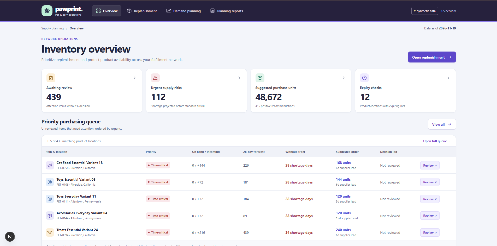
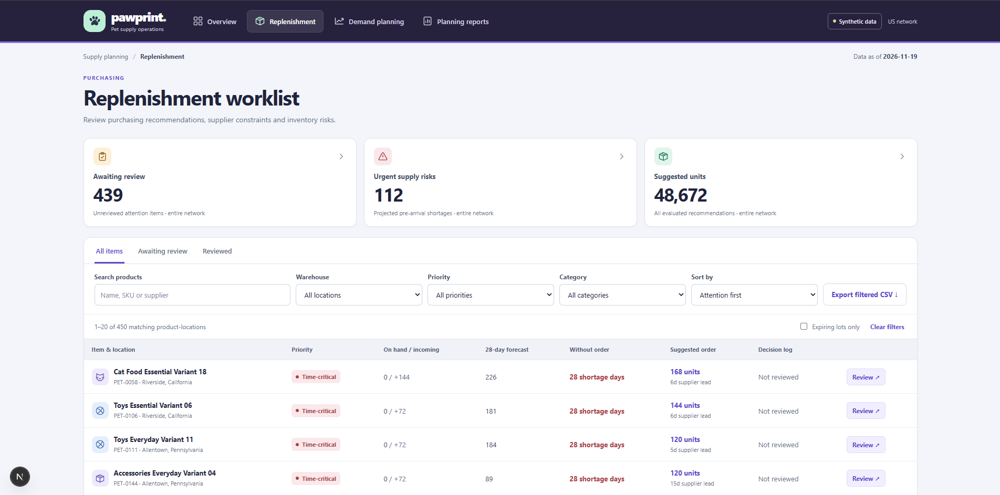
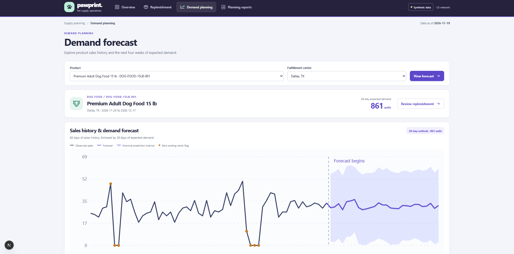
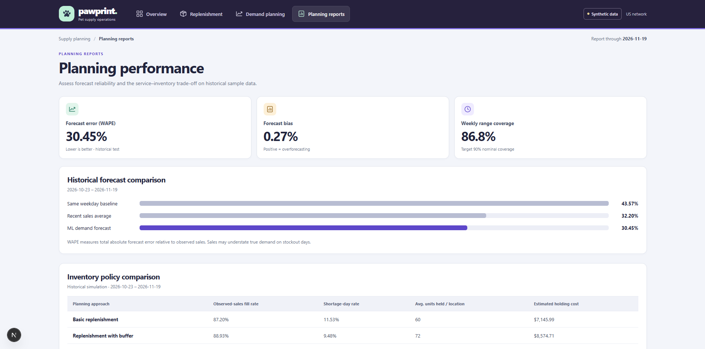
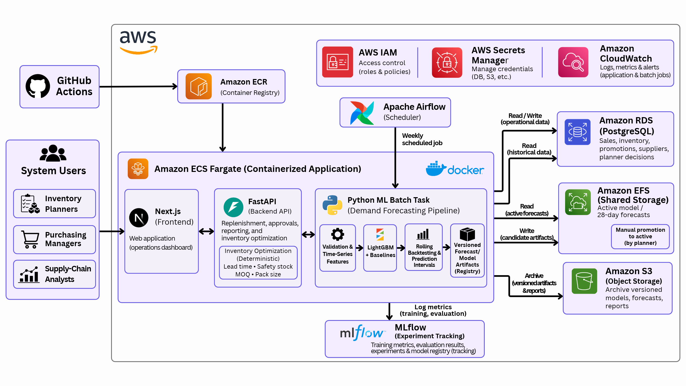

<div align="center">

# Pawprint

### Demand Forecasting & Inventory Optimization Platform

**SKU-level demand forecasting · Explainable replenishment · Human-in-the-loop purchasing · Cloud-native MLOps**

An end-to-end machine learning platform for US pet food and pet supplies retail, connecting demand forecasting, warehouse inventory, supplier constraints, and purchasing decisions in a unified operations workspace.


**[Features](#what-it-does) · [Cloud Architecture](#system-architecture) · [Quickstart](#how-to-run-the-code) · [Demo](#end-to-end-demonstration) · [Evaluation](#evaluation--verification) · [Repository](#repository-structure)**

</div>

## The problem

Online pet retailers must balance product availability against excess inventory across multiple fulfillment centers. Repeat purchases, promotions, regional demand, supplier lead times and expiration-sensitive products make manual purchasing decisions difficult. **Pawprint turns historical sales and inventory data into forward-looking, explainable replenishment decisions.**

The demonstration models a nationwide US pet retailer with 150 products, three fulfillment centers (Dallas, Riverside and Allentown), and 328,500 daily sales observations across 450 SKU–warehouse combinations. The operational dataset is synthetic.

## Product experience

### Inventory overview



### Replenishment worklist



<details><summary>Demand forecast and planning performance</summary>





</details>

## What it does

| Capability | Functionality |
| --- | --- |
| Demand forecasting | Daily SKU–warehouse forecasts for the next 28 days using global LightGBM, with weekly totals and prediction intervals. |
| Data engineering | Validated sales, promotions, supplier, inventory and stock-lot records; reproducible data preparation and PostgreSQL ingestion. |
| Inventory optimization | Order-up-to replenishment policy using lead times, review periods, safety stock, incoming orders, MOQ and case-pack constraints. |
| Purchasing workspace | Prioritized replenishment queue, shortage scenarios, expiry warnings, search, filters and CSV export. |
| Planner decisions | Approve or override recommendations with a reason and persistent decision history. |
| MLOps | Rolling backtests, versioned model artifacts, checksum verification, MLflow tracking, candidate training and offline monitoring. |

**Core stack:** Python · Pandas · NumPy · scikit-learn · LightGBM · FastAPI · SQLAlchemy · Alembic · PostgreSQL · Next.js · TypeScript · MLflow · Apache Airflow · Docker · GitHub Actions · AWS.

## System architecture

Pawprint separates offline ML training and batch forecasting from application serving and inventory decision-making. The cloud architecture integrates Docker, AWS ECS Fargate, Amazon RDS, S3, EFS, Apache Airflow, MLflow, and GitHub Actions.



| Layer | Architecture |
| --- | --- |
| Data | PostgreSQL / Amazon RDS for operational records and planner decisions; S3 for artifact and dataset archival. |
| Offline ML | Airflow weekly candidate-training DAG; lag and calendar features, LightGBM, baseline comparison, rolling evaluation and interval calibration. |
| Model lifecycle | MLflow experiment tracking, checksum-based artifact registry, operator-reviewed promotion and EFS-backed serving artifacts. |
| Serving | Next.js and FastAPI container services on ECS Fargate; deterministic purchasing calculations remain inside the backend. |
| Platform | Application Load Balancer, ECR image publishing via GitHub Actions, IAM roles, Secrets Manager and CloudWatch logging. |

## How to run the code

**Prerequisites:** Python 3.11 (Conda), Node.js 20.9+, Docker Desktop and Git. Run the following commands from the repository root using Windows Anaconda Prompt.

### 1. Environment & database

```bat
conda env create -f environment.yml
conda activate pet_forecast_env
if not exist .env copy .env.example .env
set DATABASE_URL=
python -m pip install -r backend/requirements.txt
docker compose up -d postgres
cd backend
python -m alembic upgrade head
python -m app.db.import_dataset
```

The bundled synthetic data can also be regenerated with `python -m app.data_pipeline.generate` and checked with `python -m app.data_pipeline.validate` before importing. Existing installations can reuse their configured database and Conda environment.

### 2. Train, evaluate & register

From `backend/`, generate the artifacts required by the application on a fresh installation:

```bat
python -m app.forecasting.baselines
python -m app.forecasting.lightgbm_model
python -m app.inventory.simulation
python -m app.inventory.ml_simulation
python -m app.mlops.registry register
python -m app.mlops.registry verify
```

### 3. Start the application

**Backend** (from `backend/`):

```bat
python -m uvicorn app.main:app --host 127.0.0.1 --port 8000 --workers 1
```

**Frontend** (separate terminal, from the repository root):

```bat
cd frontend
if not exist .env.local copy .env.local.example .env.local
npm install
npm run dev
```

Open **http://localhost:3000** for the planning workspace or **http://localhost:8000/docs** for the API documentation.

**Docker application profile:** After initializing the database and model artifacts, stop the host frontend/backend and run `docker compose --profile app up -d --build` from the repository root.

### 4. MLOps & cloud configuration

From the repository root:

```bat
python -m pip install -r backend/requirements-integrations.txt
cd backend
python -m app.mlops.tracking
cd ..
python -m mlflow ui --backend-store-uri sqlite:///artifacts/mlflow/tracking.db --host 127.0.0.1 --port 5000 --workers 1
```

MLflow UI: **http://localhost:5000**. Candidate training is available through `python -m app.mlops.pipeline --track` from `backend/` and the weekly Airflow DAG. Candidates remain separate from the serving artifacts until reviewed.

| Configuration | Purpose |
| --- | --- |
| `DATABASE_URL`, `DOCKER_DATABASE_URL` | Host or container PostgreSQL connection |
| `API_BASE_URL` | Next.js server-to-API connection |
| `MLFLOW_TRACKING_URI` | Experiment tracking backend |
| `PAWPRINT_S3_BUCKET`, `AWS_REGION` | Artifact storage configuration |
| `AWS_PUBLISH_ROLE_ARN`, `AWS_BACKEND_ECR_REPOSITORY`, `AWS_FRONTEND_ECR_REPOSITORY` | GitHub Actions OIDC image-publishing configuration |

The ECR workflow builds commit-tagged Docker images; ECS task definitions configure application and batch services, persistent artifact mounts and CloudWatch logging. Use runtime IAM roles and Secrets Manager for cloud credentials. Keep `.env` files, credentials and generated artifacts out of Git. The planner write API requires a private environment until identity and authorization controls are configured.

## End-to-end demonstration

Explore Pawprint through three demonstrations covering the product experience, inventory planning workflows, and the underlying ML and cloud architecture.

| Demonstration | Description | Video |
|---|---|---|
| Product Showcase | Quick overview of Pawprint and its core capabilities | [Watch Demo](YOUTUBE_VIDEO_1_URL) |
| End-to-End Client Demo | Demand forecasting, replenishment recommendations, and planner approval workflows | [Watch Demo](YOUTUBE_VIDEO_2_URL) |
| Technical Architecture | ML pipeline, LightGBM, inventory optimization, MLOps, and AWS architecture | [Watch Demo](YOUTUBE_VIDEO_3_URL) |


## Evaluation & verification

Four rolling validation folds and a separate 28-day holdout (October 23–November 19, 2026) were used to compare forecasting methods. Model selection uses rolling validation, not the final holdout.

| Model | Rolling WAPE | Holdout WAPE | MASE | Bias |
| --- | ---: | ---: | ---: | ---: |
| Seasonal naive (7 days) | 41.59% | 43.57% | 1.163 | −7.13% |
| Moving average (28 days) | 30.80% | 32.20% | 0.865 | −9.65% |
| **Global LightGBM** | **29.78%** | **30.45%** | **0.836** | **+0.27%** |

The nominal 90% prediction intervals achieved 87.62% daily and 86.83% weekly holdout coverage.

| Historical inventory policy | Observed-sales fill rate | Shortage-day rate | Simulated holding cost |
| --- | ---: | ---: | ---: |
| Moving average | 87.20% | 11.53% | $7,145.99 |
| Buffered moving average | 88.93% | 9.48% | $8,574.71 |
| LightGBM with buffer | 89.52% | 8.78% | $9,690.63 |

The inventory replay uses a pre-evaluation model fit, fixed lead times and illustrative holding costs. The metrics describe synthetic observed sales, which may be stockout-censored; they are not actual customer service levels or realized business savings.

**Verification:** 68 backend tests passed, 450 SKU–warehouse recommendations checked, and 37 metrics logged to MLflow. Model artifact integrity and forecast/replenishment consistency were verified locally.

```bat
cd backend
python -m pytest tests -q
python -m app.mlops.registry verify
cd ..
python scripts/verify_client_workflows.py
```

GitHub Actions defines backend tests, frontend builds, Docker image checks and an on-demand ECR publishing workflow.

## Repository structure

```text
Pet-Demand-Forecasting/
├── backend/
│   ├── app/
│   │   ├── api/              # FastAPI routes
│   │   ├── data_pipeline/    # Generation and validation
│   │   ├── db/               # PostgreSQL data access
│   │   ├── forecasting/      # Baselines, LightGBM, uncertainty
│   │   ├── inventory/        # Replenishment, reviews, simulation
│   │   ├── mlops/            # Registry, tracking, training, monitoring
│   │   └── cloud/            # S3 artifact integration
│   ├── migrations/
│   ├── tests/
│   └── Dockerfile
├── frontend/                # Next.js operations workspace + Dockerfile
├── data/                    # Synthetic operational data
├── airflow/dags/            # Weekly candidate-training DAG
├── deployment/aws/          # ECS task definitions and IAM example
├── scripts/                 # Workflow verification
├── docs/                    # Architecture, screenshots and technical guides
├── .github/workflows/       # Quality checks and ECR publishing
├── docker-compose.yml
├── environment.yml
├── .env.example
└── README.md
```
